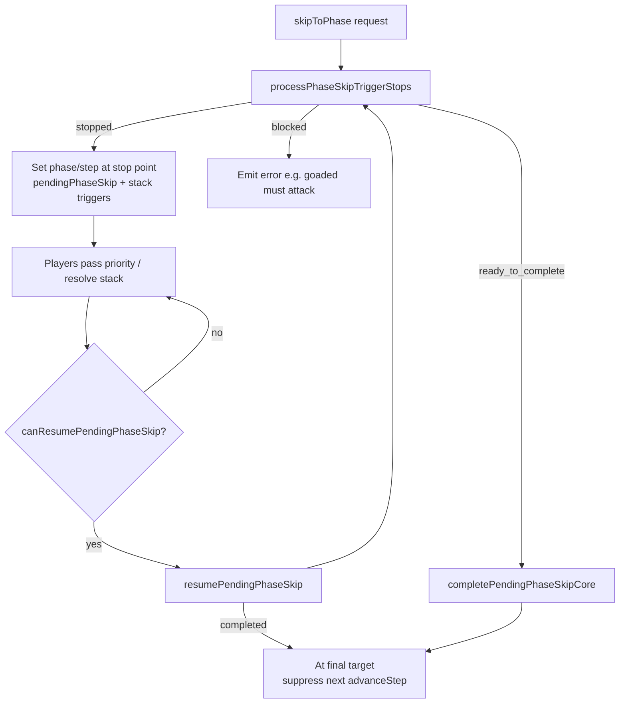

# Phase Skip Architecture

## Overview

When the active player uses **Skip to Phase** (`skipToPhase` socket action), the server cannot jump straight to the target if intermediate steps have mandatory turn-based actions or triggered abilities that must fire in the correct step. The phase-skip module scans forward step-by-step, performs turn-based actions at the right points, stops when triggers need to resolve, and resumes after priority passes clear the stack.

This mirrors normal `nextStep` behavior without requiring the player to click through every step manually.

## Entry points

| Path | File | Role |
|------|------|------|
| Initial skip | `server/src/socket/game-actions.ts` → `skipToPhase` | Active player requests `targetPhase` / `targetStep` |
| Continuation | `server/src/socket/game-actions.ts` → `passPriority` | Calls `resumePendingPhaseSkip` when stack and resolution queue are empty |
| Core logic | `server/src/state/modules/phaseSkipUtils.ts` | Scan, stop, complete, resume |
| Replay | `server/src/state/modules/applyEvent.ts` → `skipToPhase` | Restores phase/step, `pendingPhaseSkip`, untap ids, trigger-order queue |

## High-level flow



## `PendingPhaseSkip` state

Stored on `game.state.pendingPhaseSkip` while a multi-stop skip is in progress.

| Field | Purpose |
|-------|---------|
| `targetPhase`, `targetStep` | Final destination (e.g. `postcombatMain` / `MAIN2`) |
| `requestedBy` | Player who initiated the skip |
| `skipOriginPhase`, `skipOriginStep` | Where the skip started; used for deferred untap/draw on final complete |
| `lastStopStep` | Last intermediate stop (e.g. `BEGIN_COMBAT`); scan cursor advances past this on resume so triggers are not re-fired |
| `drawStepActionPerformed` | Rule 504.1 draw already ran during a DRAW stop |
| `untapStepActionPerformed` | Rule 502.3 untap already ran while scanning through UNTAP |
| `untappedDuringSkipIds` | Permanent ids untapped during scan; included on intermediate `skipToPhase` replay events |

Cleared when `completePendingPhaseSkipCore` finishes the jump.

## Scan order

`processPhaseSkipTriggerStops` walks `CURRENT_PHASE_ORDER` from the current step (or `lastStopStep + 1` on resume) toward the target:

```
UNTAP → UPKEEP → DRAW → MAIN1 → BEGIN_COMBAT → DECLARE_ATTACKERS → … → END_COMBAT → MAIN2 → END_STEP → CLEANUP
```

For each segment the scan may:

1. **Perform turn-based actions** (no stack, before step triggers)
2. **Detect triggers** for that step
3. **Stop** if any triggers survive intervening-if filtering

### Turn-based actions during scan

| Step | Action | Flag / replay |
|------|--------|----------------|
| UNTAP | `performUntapStepTurnAction` (skipped when `shouldSkipUntapStepForPlayer` is true — global Stasis or per-player `skipNextUntapStepByPlayer`) | `untapStepActionPerformed`; `untappedDuringSkipIds` on stop events |
| DRAW | `performDrawStepTurnActionDuringPhaseSkip` | `drawStepActionPerformed`; separate `drawCards` event |

### MAIN1 synchronous effects (Rule 714.3b alignment)

When scanning through MAIN1, before precombat-main triggers:

1. Saga lore counters (sync) → `saga_chapter` triggers on stack if chapters reached
2. Attraction visit roll (deferred if saga triggers pending)
3. Precombat main triggers → possible stop
4. Rad counters (sync)

If saga/rad/attraction left triggered abilities on the stack without a dedicated stop, the scan stops at MAIN1 with `existingStackTriggers: true`.

### Trigger stop points

| Stop step | Trigger source |
|-----------|----------------|
| UPKEEP | `getUpkeepTriggersForPlayer` (+ cumulative upkeep mana auto-process) |
| DRAW | `getDrawStepTriggers` (after draw turn action) |
| MAIN1 | `getPrecombatMainTriggers` |
| BEGIN_COMBAT | `getBeginningOfCombatTriggers` |
| END_COMBAT | `getEndOfCombatTriggers` |
| MAIN2 | `getPostcombatMainTriggers` |
| END_STEP | `getEndStepTriggers` |

`stopAtPhaseForTriggers` sets phase/step, pushes triggers to the stack, may queue `TRIGGER_ORDER` resolution steps, persists `skipToPhase` with `pendingPhaseSkip` and `lastStopStep`, and gives priority to the turn player.

### Goad block

Skipping **past** declare attackers while a goaded, attackable creature exists returns `blocked` (Rule 701.15b). See `docs/GOAD_IMPLEMENTATION.md`.

## Resume and `lastStopStep`

`canResumePendingPhaseSkip` requires:

- `pendingPhaseSkip` present
- Empty stack
- No pending resolution-queue steps
- No `pendingTriggerOrdering`

`resolvePhaseSkipScanIdx` advances the scan index to `lastStopStep + 1` when the stack is empty, so resuming after BEGIN_COMBAT does not re-queue begin-combat triggers.

`passPriority` sets `suppressAdvanceStepAfterPhaseSkip` when resume stops or completes, preventing a normal step advance on top of the skip jump.

## Final completion

`completePendingPhaseSkipCore` runs when the scan returns `ready_to_complete`:

1. Jump to `targetPhase` / `targetStep`
2. Clear `pendingPhaseSkip`
3. **Deferred untap** if origin was early beginning (UNTAP/UPKEEP/empty) and `!untapStepActionPerformed`
4. **Deferred draw** if origin was early beginning and target is at or past draw and `!drawStepActionPerformed`
5. Clear combat state on battlefield
6. Reset priority to turn player
7. Append final `skipToPhase` event

CLEANUP discard and `nextStep` after CLEANUP are handled by `handleSkipToCleanupPhase` in `phaseSkipUtils.ts` (called from `game-actions.ts` `skipToPhase` when the target is CLEANUP).

## Skip-untap (global and per-player)

| Mechanism | Detection | State |
|-----------|-----------|-------|
| Global (Stasis) | `hasGlobalPlayersSkipUntapSteps` — battlefield oracle contains “Players skip their untap steps” | None (derived each check) |
| Per-player (Yosei, etc.) | `playerHasSkipNextUntapStep` | `game.state.skipNextUntapStepByPlayer[playerId]` |

`shouldSkipUntapStepForPlayer` returns true for either case. When untap is skipped, `consumePlayerSkipNextUntapStep` clears the per-player flag (global Stasis is unaffected).

Oracle IR `skip_next_untap` steps set the per-player flag via `applySkipNextUntapStep` in the rules engine executor.

## Replay

Intermediate stops persist a rich `skipToPhase` event:

- `pendingPhaseSkip` (including `lastStopStep`, draw/untap flags)
- `triggerOrderRequests` when multiple triggers need ordering
- `untappedPermanentIds` when untap ran during scan

Final completion events may include `untappedPermanentIds` from deferred untap. Draws are separate `drawCards` events.

`applyEvent('skipToPhase')` restores phase/step, pending skip state, untaps listed permanents, and rehydrates trigger-order queue steps.

## Key files

| Area | Path |
|------|------|
| Phase skip core | `server/src/state/modules/phaseSkipUtils.ts` |
| Skip-untap helpers | `server/src/state/modules/skipUntapStepUtils.ts` |
| Hand size (CLEANUP discard) | `server/src/state/modules/handSizeUtils.ts` |
| Untap / draw turn actions | `server/src/state/modules/turn.ts` (`performUntapStepTurnAction`, `shouldPerformDrawStepTurnAction`) |
| Saga lore at MAIN1 | `server/src/state/modules/triggerSagaLoreUtils.ts` |
| Trigger getters | `server/src/state/modules/triggered-abilities.ts` (re-exports from `triggers/*`) |
| Socket wiring | `server/src/socket/game-actions.ts` |

## Tests

| File | Coverage |
|------|----------|
| `server/tests/skip-untap-step.utils.test.ts` | Per-player skip flag mark/consume + untap action |
| `server/tests/phase-skip-continuation.test.ts` | Unit: scan, resume, `lastStopStep`, untap/draw flags, Stasis + per-player skip |
| `server/tests/skip-to-phase.continuation.integration.test.ts` | Socket: stops, full UPKEEP and UNTAP chains, DRAW/END_COMBAT stops |
| `server/tests/skip-to-phase.replay.test.ts` | Replay: pending skip, untap ids, draw/untap flags |
| `server/tests/skipToPhase.test.ts` | Legacy untap/draw preconditions |
| `server/tests/saga-lore-counter.precombat-main.test.ts` | Saga sync + chapter triggers at MAIN1 skip |
| `server/tests/goad-baeloth.integration.test.ts` | Goad block on skip past combat |

Integration tests reset `GameManager`, `games`, DB, and `ResolutionQueueManager` per test via `resetIntegrationGame` (`server/tests/helpers/integrationGameReset.ts`).

## Known limitations

- **DECLARE_ATTACKERS / damage steps** are not individual trigger stops; goad enforcement is the main guard when skipping past combat.
- Replay of live skip paths relies on persisted events; not every side effect has a dedicated replay assertion yet.
